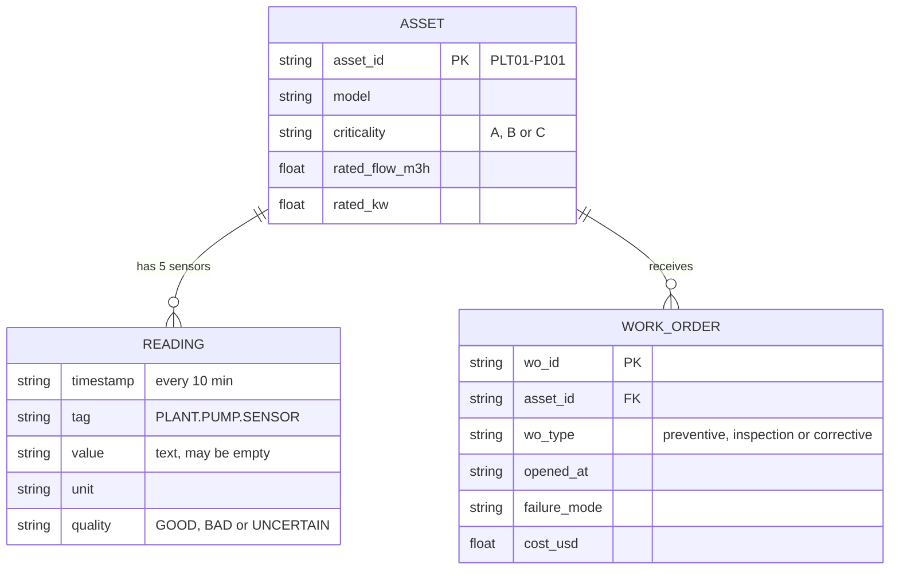
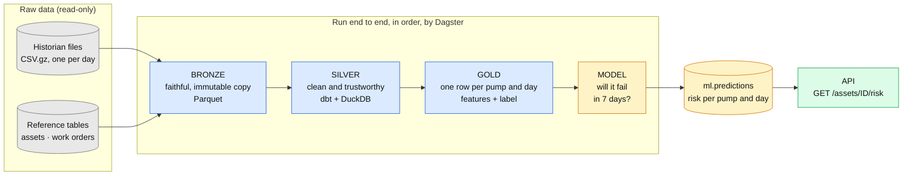
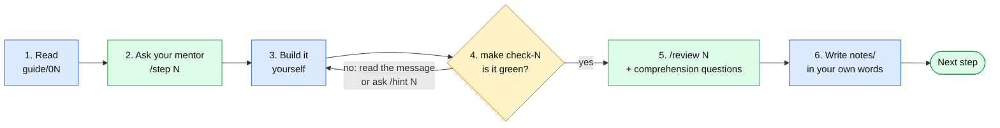
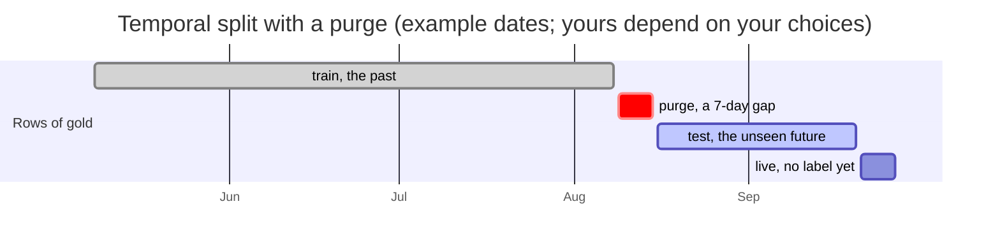

> **This is the `solution` branch: it contains a reference solution (spoilers).** Build the exercise yourself on `main` first. See [`SOLUTION.md`](SOLUTION.md).

# Build your own lakehouse

**Learn data engineering by building it.** You start from dirty raw files exported by an industrial historian and you
end with a complete, tested and automated pipeline that feeds a **pump-failure risk API**: ingestion, cleaning, features,
a model, orchestration and a service. All of it local, all of it open source.


> **Nothing is done here.** You write the code. All we give you is the data, a guide that explains the **what, why and
> what-for** of every step, and automatic checks (`make check-N`) that tell you, with data, whether what you built is right.

**Stack:** Python 3.12 · pandas · Parquet · DuckDB · dbt · scikit-learn · Dagster · FastAPI · uv

---

## The case

You are the data engineer of a company that operates a **pumping plant**: 20 centrifugal pumps moving water 24 hours a
day. When a pump fails by surprise, the plant stops and the urgent repair costs several times more than a planned one.
Marta, the maintenance manager, asks you for one thing:

> *"Every morning tell me which pumps are most likely to fail in the **next week**, so I can put them in the
> maintenance plan before they break."*

What you are given:



| Source | Where | Notes |
|---|---|---|
| Sensor readings | `data/raw/historian/` | One `.csv.gz` per day, 150 days. Vibration, bearing temperature, discharge pressure, motor current and run state |
| Pump master | `data/raw/reference/assets.csv` | Model, criticality, rated flow and power |
| Work orders | `data/raw/reference/work_orders.csv` | Preventive, inspections and **corrective repairs, which are the failures** |

And a catch: **real data comes dirty.** Part of the exercise is finding out how, because on a job nobody hands you the list.

## What you will build



| Layer | What it holds | One row is… | Built with |
|---|---|---|---|
| **Bronze** | Exactly what arrived, nothing cleaned | one raw reading, plus where and when it came in | Python + Parquet |
| **Silver** | Clean readings in standard units, no duplicates, spikes flagged | one reading of one sensor at one UTC instant | dbt + DuckDB |
| **Gold** | The model's table: features and the label | one pump on one day | dbt + DuckDB |
| **Model** | The probability that a pump fails within 7 days | one prediction per pump and day | scikit-learn |
| **API** | The latest risk of every pump | one pump | FastAPI |

## The 8 steps

| # | Step | You build | What it is for in a real job | Time |
|---|---|---|---|---|
| 0 | [Getting started](guide/00_start.md) | A working environment | The project runs the same on your machine and anyone else's | 30 min |
| 1 | [Explore](guide/01_explore.md) | Your findings notebook | Understand before building: every problem you do not see today is a bug tomorrow | 2–3 h |
| 2 | [Bronze](guide/02_bronze.md) | Idempotent ingestion | Store faithfully what arrives and always be able to reprocess | 3–4 h |
| 3 | [Silver](guide/03_silver.md) | Cleaning with dbt | Data you can trust, with tests | 4–6 h |
| 4 | [Gold](guide/04_gold.md) | Features and label | Turn clean data into the model's table without cheating with time | 3–5 h |
| 5 | [Model](guide/05_model.md) | A risk model | Predict failures with an honest evaluation | 3–4 h |
| 6 | [Orchestration](guide/06_orchestration.md) | A Dagster graph | Everything runs by itself, in order, and can be monitored | 2–3 h |
| 7 | [API](guide/07_api.md) | A FastAPI service | Other systems (and Marta) can query the result | 1–2 h |
| 8 | [What next](guide/08_next.md) | — | Production: Docker, CI, monitoring, streaming | — |

About **20–28 hours** in total. Go at your own pace: it is better to finish one step understanding it than to sprint through all eight.

## What you will be able to say in an interview

- *Idempotent ingestion:* what happens when your job is retried, and how you made sure nothing duplicates.
- *Medallion layers:* why bronze is immutable and what each layer promises.
- *Data quality:* a real problem you found in the data, the evidence, and how you fixed it.
- *dbt:* models, tests and contracts, and why a layer without tests cannot be trusted.
- *Temporal leakage:* how you proved your features do not see the future (an automatic invariance test).
- *Honest evaluation:* temporal split with a purge, a metric that fits imbalanced classes, and what a number really means.
- *Orchestration:* assets, dependencies, and what should happen when one step fails.
- *Serving:* correct status codes, read-only access and how to avoid locking the database.

## How you work: the cycle of every step



1. **Read** `guide/0N_….md`. Start with *Why this step exists*: the idea comes before the code.
2. **Ask** the mentor (optional, [Claude Code](https://claude.com/claude-code)): `/step N` brings you into the topic with questions and `/why …` explains any concept.
3. **Build** it yourself. If you get stuck, `/hint N` gives you the next hint without handing you the solution.
4. **Check**: `make check-N`. If it fails, the message tells you what is not met and why it matters.
5. **Review**: `/review N`. The mentor reads your code, points out what is wrong or fragile, and asks 2–3 questions to see whether you understood.
6. **Write** your decisions in `notes/` in your own words. If you cannot explain it, you do not master it yet.

It also works **without Claude Code**: the guide and the checks are self-sufficient.

## Get started

You need [uv](https://docs.astral.sh/uv/) (on macOS: `brew install uv`) and `make`. Python 3.12 is installed by uv.
Tested on macOS (Apple Silicon); on Windows use WSL. No cloud account and no Docker are needed.

```bash
git clone https://github.com/100FOUNTS/build-your-own-lakehouse.git
cd build-your-own-lakehouse
make setup          # installs the dependencies
make check-0        # is everything ready?
make progress       # which steps are already green
```

Then open [`guide/00_start.md`](guide/00_start.md).

## One idea you will meet in the middle: no cheating with time

Step 5 asks you to evaluate a model that predicts the future. If you split the rows at random, the model "predicts"
Wednesday after training on Tuesday of the same failure, and the numbers look spectacular and false. The honest evaluation
trains with the past and tests with a future the model never saw, leaving a gap so that no label overlaps:



## Rules of the game

1. **`data/raw/` is never edited.** It is what arrived; if you change it you lose the evidence. (A check watches it.)
2. **Do not open `checks/_truth.json`** until you finish: it lists the problems hidden in the data. If you open it you take the learning out of step 1.
3. **There is no single solution.** The checks verify results and properties (does it duplicate when repeated? is there temporal leakage?), not your style.
4. **Paths are not written in the code**: use the ones in `src/lakehouse/paths.py` (`LH_*` variables), so your pipeline runs in any folder, as a real one does.

## Repository map

```
guide/              the step-by-step guide (start at 00_start.md) and a glossary
notes/              YOUR notebook: findings, decisions, learning log (templates to fill in)
src/lakehouse/      YOUR Python code (bronze.py, train.py, definitions.py, api.py); paths.py is provided
dbt/                YOUR dbt project (silver and gold models)
tests/              YOUR tests (the temporal-leakage one is mandatory)
checks/             the automatic checks of each step (make check-N)
data/raw/           the raw data (read-only)
data/incoming/      10 more days that "arrive" later with `make arrival`
tools/              helper scripts (progress, arrival)
.claude/            optional mentor mode for Claude Code (/step, /hint, /why, /review)
Makefile            shortcuts: bronze, silver, gold, train, run, dagster, api, check…
```

## FAQ

**Do I need Claude Code?** No. It adds a mentor that asks questions and gives graduated hints without writing your
solution, but the guide and the checks work on their own.

**What if I get stuck?** Each step has hints in increasing order of help, collapsed inside the guide. Open them one at a
time. The checks' messages also tell you what is not met and why it matters.

**Where is the solution?** On the [`solution`](../../tree/solution) branch, with a spoiler warning. Build the exercise first:
the learning is in the building. Then compare **decisions**, not code.

**Can I use my own language for the notes?** Yes. The step 1 check understands English and Spanish.

**Why is some data in Spanish?** The data was generated with a few Spanish values (failure modes such as `rodamiento`,
`sello`, `cavitacion`), as a real plant would have. The guide and the code are in English.

**How is this different from a tutorial?** A tutorial hands you the code. Here you write it, the data is messy on purpose,
and the checks recompute the truth independently, so a green check means your result is right, not that you copied well.

## When you finish

Compare with the `solution` branch and read [`guide/08_next.md`](guide/08_next.md): improvement challenges, what is missing to
take it to production (Docker, CI, observability, streaming) and how to tell this project in an interview.

## Contributing

Found a typo, an unclear explanation or a check that gives a wrong verdict? Open an issue or a pull request. If you solved
the exercise differently from the reference and a check rejected a valid design, that is especially valuable feedback.

## License

[MIT](LICENSE)
