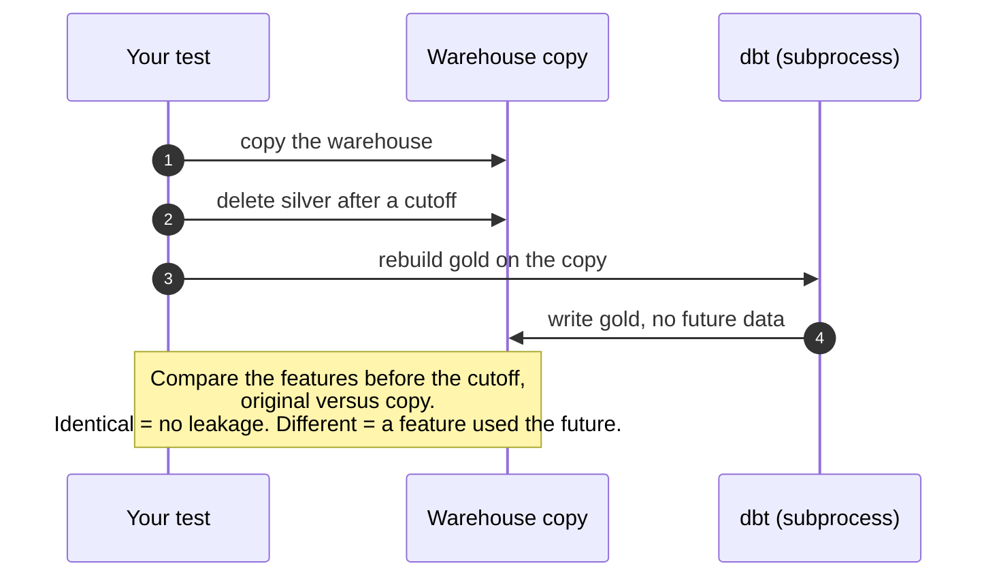

# Step 4 — Gold: the model's table (without cheating with time)

⏱ 3–5 h · Deliverable: `dbt/models/gold/` + `tests/test_no_leakage.py` · Check: `make check-4`

## What you are going to build

A single table, `gold.asset_daily_features`, with **one row per pump and day**:

```
asset_id    feature_date   vib_mean  vib_std  temp_mean  …   label_failure_7d
PLT01-P101  2026-06-10     1.12      0.05     63.1       …   0
PLT01-P101  2026-06-11     1.15      0.06     63.4       …   0
PLT01-P107  2026-07-02     2.31      0.21     71.9       …   1     ← this pump will fail within the next 7 days
```

- The **features** are numbers that summarize how the pump behaved that day (and the previous days).
- The **label** `label_failure_7d` is the answer we want to learn: did it fail in the following week?

And a test, `tests/test_no_leakage.py`, that proves your features do not cheat.

How the leakage test you will write works:



## Why this step exists

A machine learning model does not understand millions of 10-minute readings: it understands **a table where each row is an
example** ("this pump, this day") with columns that describe the situation and a column with the answer. Turning clean
data into that table is called *feature engineering*, and it usually adds more quality to the model than any
sophisticated algorithm.

Gold is **where the business knowledge lives**: what "failure" means (a corrective order), which prediction window is
useful (7 days: what maintenance needs to plan), which behaviors betray a sick pump
(higher vibration, more temperature, falling pressure).

## The most expensive mistake of this step: temporal leakage

Imagine the model is going to decide **today** (day D) which pumps to inspect. It only knows what happened until the end of day D.
Now imagine a feature like "average vibration of the 7 days *centered* on D". It computes with 3 days of the future. With
that feature the model "discovers" the degradation before it happens… in your historical data. In production those 3 days
do not exist yet, and the model drops from 95 % to 20 % without any error warning you.

This is called **data leakage**. It is the number one cause of models that "work" in the notebook and
fail in production. The defense is an automatic test: **if I delete all the data after day D, the features
of the days before D cannot change.** You write that test in this step.

## What it is for in a real job

The feature table is, in companies with ML, a product in itself (*feature store*). Knowing how to build it reproducibly and
without leakage is what distinguishes a reliable data/ML engineer. And the temporal invariance test is one of
those that impress the most in a code review.

## Concepts you need

- **Feature**: numeric column that describes the situation. E.g.: mean vibration of the day, its deviation, its change relative
  to the average of the last 28 days.
- **Label**: what you want to predict. Here: `1` if there is a **corrective** order opened between the day after and
  7 days after `feature_date`; `0` if not.
- **Prediction window (horizon)**: how many days ahead you predict (7).
- **Right censoring**: for the last 7 days of data you do not yet know whether the pump will fail, because the future has not happened.
  Those rows **have no label** (`NULL`): they are not `0`. (But you keep them: they are the ones you score "today".)
- **Rolling window**: a computation over the previous N days. `ROWS BETWEEN 6 PRECEDING AND CURRENT ROW` looks back;
  any `FOLLOWING` looks into the future (careful).
- **Own baseline**: comparing a pump with **its own past** (today's vibration minus its average of the last 28
  days) is usually more informative than the absolute value, because each pump has its own normal level.
- **Operating state**: a stopped pump has vibration ≈ 0. If you average stops with operation, the average measures how long
  it was stopped, not its health.

## The contract

**`gold.asset_daily_features`**

| Column | Rule |
|---|---|
| `asset_id` | The 20 pumps |
| `feature_date` | UTC day (DATE). **Unique grain**: one row per `(asset_id, feature_date)` |
| ≥ 8 numeric features | With names of your own. Less than 50 % nulls each; none with correlation > 0.9 with the label (that is almost always leakage) |
| `label_failure_7d` | `1` if there is a corrective order opened in `(feature_date, feature_date + 7 days]`, `0` if not, **`NULL` in the last 7 days of data** |

- You must cover ≥ 90 % of the (pump, day) pairs with data in silver.
- Also keep the latest unlabeled days (you will need them in steps 5 and 7).
- Schema `gold` (or `main_gold`).

**dbt tests**: ≥ 3 in gold (grain, `not_null` of the keys, accepted values of the label).

**`tests/test_no_leakage.py`**: your temporal invariance test (see below). The check runs it **and also does its own,
independent one**, rebuilding gold on a copy without the future.

## Your task

1. **Define 6–10 features by hand** thinking like maintenance: what changes in a pump before it fails? Look at the plots
   you made in step 1. Write in `notes/04_gold_decisions.md` why each feature should work.
2. **Write `dbt/models/gold/asset_daily_features.sql`** (and register the `gold` schema in `dbt_project.yml`):
   - valid readings (what do you do with `is_outlier`?), pivoted to one row per instant,
   - **daily** aggregation, taking the operating state into account,
   - rolling windows **backwards** (7-day rolling, delta against the previous 28 days…),
   - the label from `work_orders`, with `NULL` where it applies.
3. **Descriptions and tests** in `schema.yml`.
4. **Write `tests/test_no_leakage.py`.** Outline of the test:
   - copy the warehouse to a temporary folder,
   - delete from the copy the silver readings after a cutoff date,
   - rebuild gold on the copy (dbt with `LH_WAREHOUSE` pointing to it; do it in a **subprocess** so dbt releases the file),
   - compare the features of the days before the cutoff: they must be **identical**.
5. **Provoke a leak on purpose**, just to see your test fail (change a window to `… AND 3 FOLLOWING`), and
   put it back. A test you have never seen fail is not a test.
6. **Look at your data**: how many rows you have, how many positive labels (what percentage?), and plot a pump with a failure
   during the 3 weeks before it.

## How you will know you are done

```bash
make gold
make check-4
```

## Comprehension questions

1. Why do the last 7 days have a `NULL` label and not `0`? What would happen to the model if they were `0`?
2. Why does the `ROWS BETWEEN 28 PRECEDING AND 1 PRECEDING` window for the baseline *exclude* the current day? (Think about what happens
   with the signal of a sudden failure.)
3. If one day a pump was stopped for 20 hours, what happens to your `vib_mean`? How do you avoid it?
4. Why are only ~7–9 % of the rows positive, and why is that going to matter in step 5?
5. What other leak (not from windows) could there be? Hint: what information about a failure does the system *know* on the same day of
   the failure but not before?

## Hints

<details><summary>Hint 1 — Query structure</summary>

Three steps in CTEs: (1) pivot `sensor_readings` to one column per sensor (`max(case when sensor='…' then value end)`
grouping by pump and instant), (2) aggregate by day with `avg(...) filter (where run = 1)`, (3) rolling windows over the
daily table. The label is a separate subquery with `exists` over the corrective orders.
</details>

<details><summary>Hint 2 — Which features usually work for this</summary>

Daily mean and maximum of vibration, of temperature, standard deviation of vibration and pressure (cavitation makes them
oscillate), current, fraction of the day in operation, number of readings (coverage), and the **deltas against its own 28-day
baseline**. You do not need all of them; you need to understand why each one.
</details>

<details><summary>Hint 3 — Outline of the leakage test</summary>

```python
shutil.copy(real_warehouse, tmp / "wh.duckdb")            # copy
duckdb.connect(tmp/"wh.duckdb").execute("delete from silver.sensor_readings where ts_utc >= timestamp '2026-08-15'")
subprocess.run([sys.executable, "-c", "from dbt.cli.main import cli; cli()", "build", ..., "--select", "path:models/gold"],
               env={**os.environ, "LH_WAREHOUSE": str(tmp/"wh.duckdb")})
# compare features (without the label) with feature_date < '2026-08-15' in both databases: they must be equal
```
Why a subprocess? DuckDB only lets one process write the file at a time.
</details>

<details><summary>Hint 4 — The day of the failure</summary>

A pump that fails on day D already shows its worst behavior that day. If your label counts a failure on the same day D,
you are asking the model to "predict what already happened". The contract's definition (days `D+1` to `D+7`) is deliberate.
</details>

## Common traps

- **`FOLLOWING` in any window**, or using aggregates over the **whole table** (e.g. normalizing by the global mean).
- **Averaging stops with operation** (vibration "drops" because the pump was off).
- **Not normalizing `wo_type`** (if you did not fix it in silver, you will lose failures in the label).
- **`0` label in the last 7 days**: it looks harmless and teaches the model that "nothing fails at the end".
- **Inner join that drops days** without a certain reading (you will lose rows and it will not show).

## In a real job

Here the same principle is called *point-in-time correctness*: when building historical features for training, each row
must reflect exactly what was known at that moment. *Feature stores* (Feast, Databricks Feature Store) exist
mostly to guarantee it. The test you write today is the minimal version of that guarantee.

→ Next: [`05_model.md`](05_model.md)
