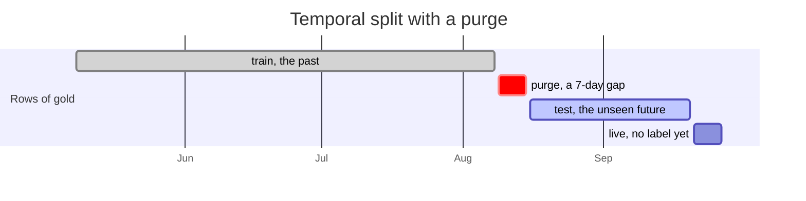

# Step 5 — The model: predict with an honest evaluation

⏱ 3–4 h · Deliverable: `src/lakehouse/train.py` · Check: `make check-5`

## What you are going to build

A program (`python -m lakehouse.train`) that:

1. reads `gold.asset_daily_features`,
2. trains a model that estimates **the probability that a pump fails within the next 7 days**,
3. evaluates it **honestly** (splitting by time, not at random),
4. saves the model, the metrics (`data/models/metrics.json`) and an `ml.predictions` table with the risk of **each pump
   and day**, including the latest days without a label (the risk of "today").

## Why this step exists

Everything comes together here: clean data (silver), the table of examples (gold) and Marta's question. But the step is not
about choosing the most modern algorithm — for this table a simple model works well —. It is about something harder and
more important: **how do you know your model really works?**

A badly evaluated model is worse than having no model, because it conveys a confidence that does not exist. There are three
classic ways to fool yourself, and this step forces you to dodge them:

1. **Mixing time.** If you split the rows at random into training and test, the model trains on Tuesday and
   "predicts" Wednesday of the same failure (almost identical neighbors). Spectacular, false results. In production
   you always predict **into the future**, so the evaluation must do the same: train with the past, test with
   a future the model did not see.
2. **Forgetting the gap (purge).** The label of a training row looks 7 days ahead. If you train until
   day D and test from D+1, some training labels "contain" results of the test period.
   You must leave a gap of at least 7 days between the two.
3. **Using the wrong metric.** Only ~8 out of 100 days are positive. A model that always answers "it will not fail"
   is right 92 % of the time and is useless. That is why *accuracy* is not used here.

The temporal split you will build (example dates; yours depend on your choices):



## What it is for in a real job

The conversation with the business is never "my AUC is 0.9". It is: *"of the 11 failures there were in the last month and a half, how many
would we have seen in time? And how many healthy pumps would we have inspected for nothing?"*. Translating model metrics into
decisions is part of the job. This step makes you feel it, with an optional challenge at the end.

## Concepts you need

- **Binary classification with imbalanced classes**: few positives among many negatives.
- **Probability / risk (`risk_score`)**: the model returns a number between 0 and 1; it does not decide by itself what to do.
- **Average Precision (AP)**: summarizes how well the model *ranks* the pumps (do the ones that will fail end up on top?). It is compared
  with **chance**, which gives AP ≈ proportion of positives (~0.08 here). An AP of 0.5 is six
  times better than chance.
- **Temporal split with purge**: `train` (past) · gap ≥ 7 days · `test` (future). Never random.
- **Overfitting**: the model memorizes the training set and does not generalize. It is detected by comparing training
  vs. test.
- **Model artifact**: the file with the trained model (`joblib`/`pickle`). Without it you can neither serve nor reproduce it.
- **`split = 'live'`**: recent rows that you *score* but cannot evaluate (they do not have a label yet).

## The contract

**Execution**: `python -m lakehouse.train` (or `make train`) reads `gold.asset_daily_features` and writes:

**`data/models/model.<ext>`** — the trained model (any format).

**`data/models/metrics.json`** with at least:
```json
{
  "train_end": "2026-07-30",
  "test_start": "2026-08-07",
  "average_precision": 0.0,
  "baseline_average_precision": 0.0,
  "n_test_rows": 0,
  "n_test_positives": 0
}
```
(`baseline_average_precision` = proportion of positives in test = what chance would give.)

**`ml.predictions`** in the warehouse, one row per `(asset_id, feature_date)`:

| Column | What it is |
|---|---|
| `asset_id`, `feature_date` | The key |
| `risk_score` | Probability between 0 and 1 |
| `split` | `train`, `test`, `live` (and optionally `purge` for those in the gap) |

**Rules the check verifies:**
- `test_start − train_end ≥ 7 days`; all `train` earlier than all `test`; the `split` rows match the dates you report.
- Test with at least 400 rows and 25 positives (≈ 6 weeks). If you reserve too little, the metric is noise.
- AP on test **≥ max(0.30, 3 × chance)**, and recomputed from `ml.predictions` it matches the one you report (±0.02). A nearly perfect AP (> 0.995) is considered suspicious of leakage.
- There is a recent prediction for the 20 pumps, with `split = 'live'` on the days without a label.

## Your task

1. **Read gold** and decide which columns are features (never `label_*`, never keys!).
2. **Define the temporal split**: how many test days? How many gap days? Write it down and justify it in `notes/05_model_decisions.md`.
3. **Train a first simple model** (`sklearn.ensemble.HistGradientBoostingClassifier` handles nulls without preprocessing;
   `LogisticRegression` needs imputing and scaling; try both if you want to compare).
4. **Measure**: `average_precision_score` on test, and compare it with chance. Also compare against training: is there
   overfitting?
5. **Score all the rows** of gold (also `live`) and write `ml.predictions` and `metrics.json`; save the model.
6. **Look at the errors**: which failures does it detect well and which not? (Hint: failure modes behave differently, and the
   days *before* the failure are not all equally detectable.)
7. **Answer** `notes/05_model_decisions.md`.

## How you will know you are done

```bash
make train
make check-5
```

## Optional challenge (`make bonus`) — speak the language of the business

Add to `metrics.json`: `threshold` (the risk from which an alert is raised), `event_recall` (of the real failures of the
test period, in how many was there **at least one alert** in the previous 7 days?) and
`false_alerts_per_100_healthy_days`. Choosing the threshold is a **cost** decision (how much does missing a failure cost compared with
an unnecessary inspection?), not a statistical one.

## Comprehension questions

1. Why does an accuracy of 92 % say nothing here?
2. Explain with a concrete example what would happen if you split at random. And if you left the gap at 0 days?
3. What does comparing train AP and test AP tell you?
4. Your test AP is 0.8. Is that enough to say "the model is good"? What else would you want to know? (Hint: how many independent failures are there really in test?)
5. If tomorrow data arrives from a new plant with different pumps, what do you expect to happen to the model and how would you monitor it?

## Hints

<details><summary>Hint 1 — How to build the split</summary>

`labeled = df[df.label_failure_7d.notna()]`; `test_start = labeled.feature_date.max() − (N_test − 1) days`;
`train_end = test_start − gap`; `train = labeled[feature_date <= train_end]`. The rows between `train_end` and `test_start`
are used neither to train nor to evaluate (`split = 'purge'`).
</details>

<details><summary>Hint 2 — Train and score</summary>

```python
model = HistGradientBoostingClassifier(max_depth=4, learning_rate=0.05, max_iter=200, random_state=0)
model.fit(train[features], train["label_failure_7d"].astype(int))
df["risk_score"] = model.predict_proba(df[features])[:, 1]
```
</details>

<details><summary>Hint 3 — Write the table in DuckDB</summary>

`con.register("pred_df", pred)` and then `create or replace table ml.predictions as select * from pred_df`
(remember `create schema if not exists ml`). Open the write connection only at the end and close it.
</details>

<details><summary>Hint 4 — My AP is low</summary>

Before changing the model, look at the features: do they distinguish a degrading pump from a healthy one? If not, no algorithm
will. Check especially how you treat stops and whether you include deltas against the own baseline. The problem is almost never
the algorithm.
</details>

## Common traps

- **`train_test_split(shuffle=True)`**: the classic trap. Great, false results.
- **Including `label_*` columns or keys as features.**
- **Choosing hyperparameters by looking at the test** (the test gets "spent": if you tune against it, it no longer measures anything). To tune,
  set aside a validation slice inside training.
- **Reporting a metric different from the one you save** (the check recomputes the AP from `ml.predictions`).
- **Overwriting `metrics.json` with hand-written values.** They are computed.

## In a real job

This is where **MLflow** appears (recording every experiment, parameters, metrics and artifacts to compare runs) and a
*model registry* (versioning and promoting models). Your `metrics.json` is the minimal version of that registry: one run, its
numbers and its model.

→ Next: [`06_orchestration.md`](06_orchestration.md)
