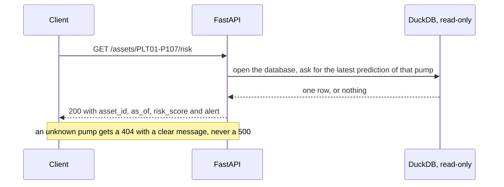

# Step 7 — The API: deliver the result

⏱ 1–2 h · Deliverable: `src/lakehouse/api.py` · Check: `make check-7`

## What you are going to build

A web service (FastAPI) that answers Marta —or the maintenance system— with the **most recent** risk of each pump:

| Request | Response |
|---|---|
| `GET /health` | `{"status": "ok"}` (are you alive?) |
| `GET /assets` | The 20 pumps with their latest risk, **sorted from highest to lowest risk** |
| `GET /assets/PLT01-P107/risk` | `{"asset_id": "PLT01-P107", "as_of": "2026-09-27", "risk_score": 0.83, "alert": true}` |
| `GET /assets/DOES-NOT-EXIST/risk` | **404** with a clear message |

What happens on a request:



## Why this step exists

So far your work lives in a DuckDB file that only you know how to open. A model that nobody can query does not
change any decision. An **API** is the contract between your platform and the rest of the world: whoever consumes it does not need to
know about DuckDB, dbt or scikit-learn; they just make an HTTP request and receive JSON.

It also separates responsibilities: the pipeline (steps 2–6) **writes**; the API **only reads**.

## What it is for in a real job

Almost every data result ends up delivered through an API, a dashboard or a shared table. Knowing how to expose an
endpoint with validation, correct error codes and without blocking the database is what turns a data person into
someone who "delivers product". It is also a typical interview question ("how would you serve this model?").

## Concepts you need

- **Endpoint**: a URL + HTTP method that does something (`GET /assets`).
- **JSON / response model**: the shape of the data you return. With **Pydantic** you declare it and FastAPI validates and documents it.
- **Status codes**: `200` ok, `404` does not exist, `422` malformed request, `500` your error (avoid it!).
- **Automatic documentation**: FastAPI generates `/docs` (Swagger) without you writing anything extra. Open it.
- **Read-only**: the API opens DuckDB with `read_only=True`; that way it does not compete for the single writer with dbt or with your pipeline.
- **Connection per request**: opening/closing per request is the simplest and safest for this data size.

## The contract

**`src/lakehouse/api.py`** defines `app = FastAPI(...)`.

| Endpoint | Must satisfy |
|---|---|
| `GET /health` | 200 |
| `GET /assets` | 200 + list of 20 elements with `asset_id`, `risk_score`, `as_of`; **descending** order by `risk_score` |
| `GET /assets/{asset_id}/risk` | 200 + `asset_id`, `risk_score`, `as_of` (date of that pump's **most recent** prediction); `risk_score` matches `ml.predictions` |
| unknown pump | **404** (not a 500) |

(If you add `alert` —risk above a threshold— even better: justify the threshold in your notes.)

## Your task

1. Create `app = FastAPI(...)` and the `/health` endpoint.
2. A helper function that opens DuckDB **read-only** with `paths.warehouse_path()` and closes by itself.
3. The "latest prediction per pump" query (`row_number() over (partition by asset_id order by feature_date desc)`).
4. `/assets` and `/assets/{asset_id}/risk` with Pydantic response models.
5. Handle the unknown case with `HTTPException(status_code=404, detail=…)`.
6. **Test it for real**: `make api` and open http://localhost:8000/docs; run every endpoint from there, and try a made-up ID.
7. **Ask yourself what is missing for production** (go to the questions below).

## How you will know you are done

```bash
make run          # make sure you have a fresh ml.predictions
make check-7
```

Optional challenge (`make bonus`): verify that your API **does not leave the database locked** (open the connection per request, close it).

## Comprehension questions

1. Why `404` and not `500` for an unknown pump? Who is harmed by a 500?
2. What would happen if the API opened the database in write mode and the pipeline ran at 6:00? And if it does so in read-only mode?
3. Today the API reads a table written by the pipeline. What happens if the pipeline fails and the table is from yesterday? How would whoever consumes the API notice? (Hint: what is `as_of` for?)
4. What would you change if the API received 1000 requests per second?
5. What sensitive information could leak through an error message?

## Hints

<details><summary>Hint 1 — Skeleton</summary>

```python
from fastapi import FastAPI, HTTPException
from pydantic import BaseModel
app = FastAPI(title="Pump failure risk")

class Risk(BaseModel):
    asset_id: str
    as_of: str
    risk_score: float

@app.get("/health")
def health(): return {"status": "ok"}
```
</details>

<details><summary>Hint 2 — Query DuckDB without dangerous parameters</summary>

`con.execute("select … where asset_id = ?", [asset_id])` — with a bound parameter, never concatenating the text: that way you
avoid SQL injection.
</details>

## Common traps

- **Returning the oldest prediction** instead of the most recent one (or mixing dates between pumps).
- **Concatenating `asset_id` into the SQL** (injection).
- **Forgetting to close the connection**: the database stays locked for dbt.
- **A 500 with a full traceback** when the cause is an invalid user input.

## In a real job

You would put the API behind authentication, package it in a container (Docker), add metrics and traces (to know
how long it takes and how many requests fail), and the database would probably be Postgres or a data warehouse, not a file.
But the contract (which endpoints, which response shape, which errors) is designed exactly as you did.

→ Next: [`08_next.md`](08_next.md)
